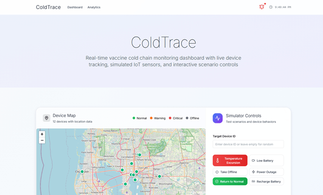
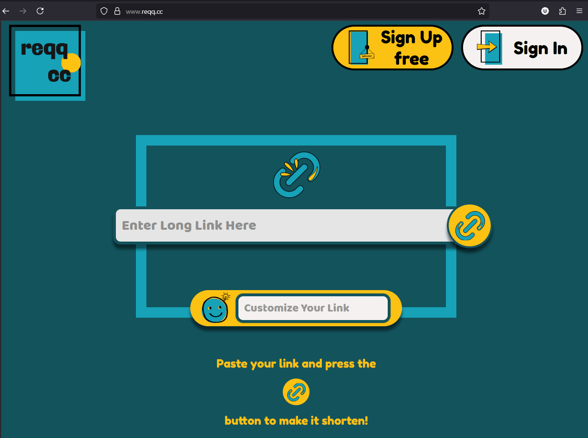

# Hi, I'm Umut 👋

## Software Engineer | TypeScript · React · Next.js · NestJS | Real-time Data, IoT & Regulated Life-Sciences Systems

I build production-grade web applications — real-time dashboards, multi-tenant SaaS, and traceability
systems for GxP-regulated pharmaceutical environments. Open to software-engineering roles across the
React and Node ecosystems.

📍 Tampa, FL · 🌐 [utoker.com](https://www.utoker.com)

---

## 🚀 Featured Projects

### [ColdTrace](https://coldtrace.app/) — Real-time IoT Cold-Chain Monitoring

A vaccine cold-chain monitoring platform that streams live sensor telemetry to a dashboard with
interactive maps, excursion alerts, and compliance analytics. Delivers **4,500+ messages/sec to 30
concurrent clients at sub-350ms p95**, with Recharts views over 100K+ data points and a Node.js
simulation engine that generates synthetic sensor data to stress-test the UI.

_Tech_: Next.js 15, React 19, TypeScript, Apollo GraphQL (WebSocket subscriptions), Prisma, PostgreSQL, Recharts, Leaflet, Turborepo, Docker
&nbsp;·&nbsp; [Repo](https://github.com/utoker/coldtrace)

---

### [Reqq.cc](https://reqq.cc) — Privacy-minded Edge URL Shortener

**Sub-40ms global redirects** via Next.js Edge Runtime across 30+ Vercel PoPs. Click analytics stay
atomic under 1K+ concurrent requests through Postgres stored procedures, with RLS-enforced link
ownership and tiered Redis rate limiting. Rebuilt from a Pages Router / PlanetScale v1 into App
Router + Server Actions, dropping client-side state management in favor of React 19 `useActionState`.

_Tech_: Next.js 15 (Edge Runtime), React 19, TypeScript, Supabase (Postgres), Redis, Vitest
&nbsp;·&nbsp; [Repo](https://github.com/utoker/link-shortener)

---

### [LaunchKit](https://saas-boilerplate-utokers-projects.vercel.app) — Production SaaS Boilerplate

A 0-to-1 SaaS starter with zero-trust per-user data isolation enforced at the database layer via
PostgreSQL Row-Level Security, the full Stripe subscription lifecycle (Checkout, Customer Portal,
3 webhook event types), and real-time AI chat over SSE streaming. Per-user AI quotas are enforced in
the DB rather than the app; Vitest + RTL coverage spans the DAL, server actions, Stripe webhooks,
and chat UI.

_Tech_: Next.js 16, React 19, TypeScript (strict), Supabase, Stripe, Anthropic Claude via Vercel AI SDK, Vitest
&nbsp;·&nbsp; [Repo](https://github.com/utoker/launchkit)

---

### [airmon](https://airmon.utoker.com) — Air-Quality Telemetry API on a Raspberry Pi

A FastAPI service that ingests batched sensor readings (PM particulates, CO₂, temperature/humidity)
from a Raspberry Pi 4 and serves them back over REST. The store is tiered time-series SQLite — raw
readings for 14 days, 1-minute aggregates for 90 days, 1-hour aggregates indefinitely — with
automatic tier selection that caps any range query to 200–2,000 points regardless of window size.

_Tech_: Python, FastAPI, Pydantic, Uvicorn, SQLite, Raspberry Pi 4
&nbsp;·&nbsp; [Repo](https://github.com/utoker/airmon)

Deployment for airmon and ColdTrace runs on my own hardware via
[**homelab**](https://github.com/utoker/homelab) — systemd units, a Caddy reverse proxy for custom
subdomains, a dynamic-DNS updater, and backup/restore scripts.

---

## 👨‍💻 About Me & My Stack

* **Current work:** Technical Specialist (Contract) at **Advanco SA**, supporting and implementing
  GxP-regulated MES/LES deployments for enterprise pharmaceutical clients — Level 2 production
  support, version upgrades, connector integrations, and IQ/OQ/PQ qualification.
* **Previously:** Sole engineer at **Tracius**, building a multi-tenant, GS1-compliant (EPCIS 2.0)
  pharmaceutical serialization platform 0-to-1 — NestJS, Next.js, Prisma, and a Turborepo monorepo,
  with a GS1 Digital Link resolver load-tested to sub-500ms p95.
* **Core stack:** TypeScript, React, Next.js, Node.js, NestJS, GraphQL, Prisma, PostgreSQL, Redis,
  Python (FastAPI/Django), Docker, AWS, Azure, Zustand, Recharts, Leaflet.
* **Domain:** GxP · GAMP 5 · 21 CFR Part 11 · DSCSA · EU FMD · GS1 Digital Link · EPCIS · MES/LES ·
  serialization & track-and-trace.
* **Education & certs:**
  * M.S. Software Engineering (Domain-Driven Design), Western Governors University — 2026
  * AWS Certified Cloud Practitioner
  * Microsoft Azure Fundamentals (AZ-900)
  * Apollo GraphQL Associate

---

## 🔥 GitHub Stats

---

## 🐍 Contribution Graph

---

## 🙋 Let's Connect

[Email](mailto:utoker@gmail.com) · [Website](https://www.utoker.com) · [GitHub](https://github.com/utoker) · [LinkedIn](https://www.linkedin.com/in/utoker/)
